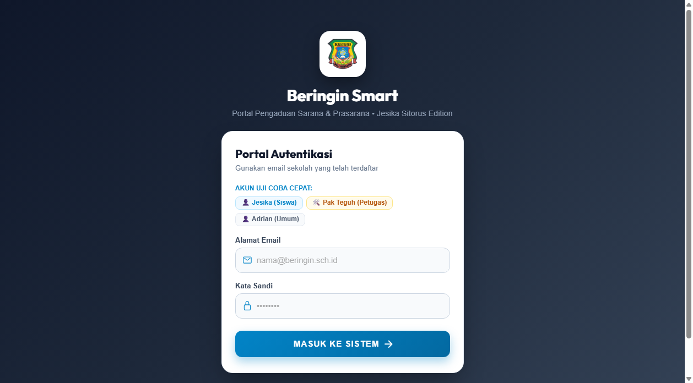
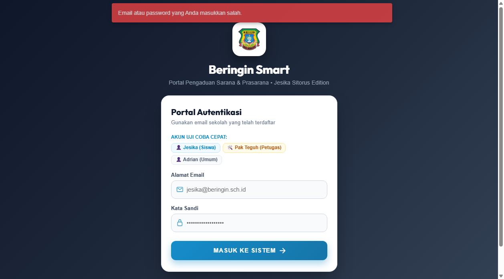
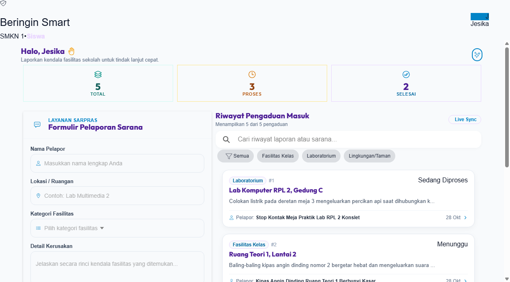
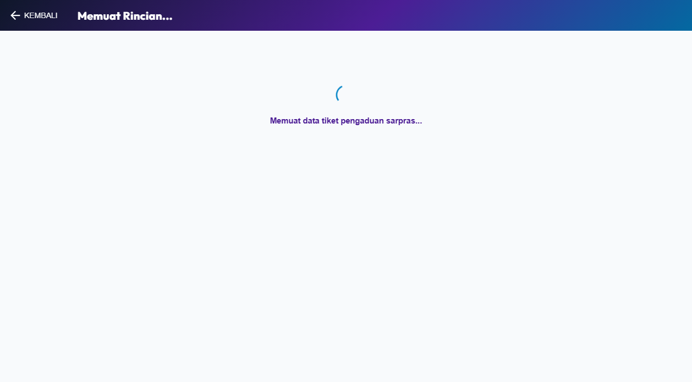
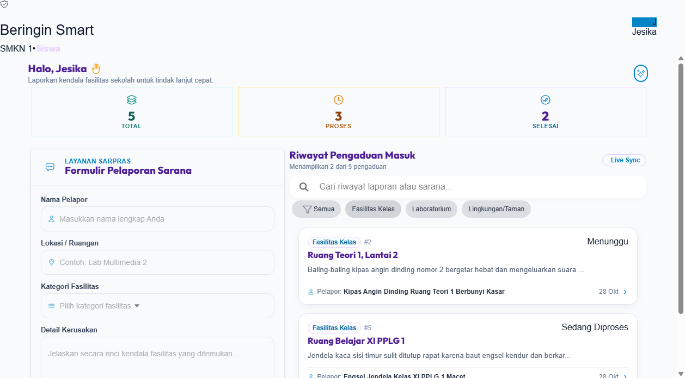
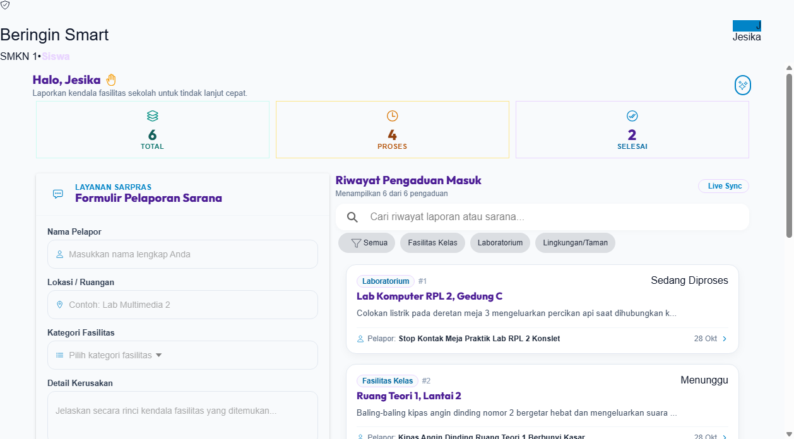
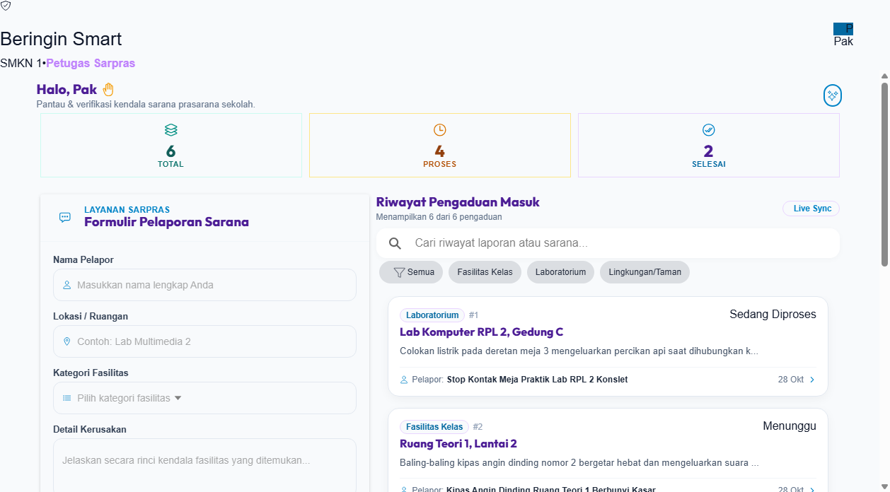
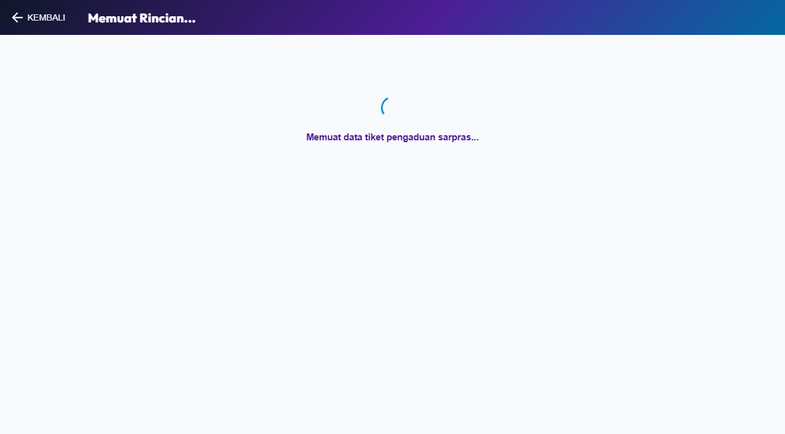
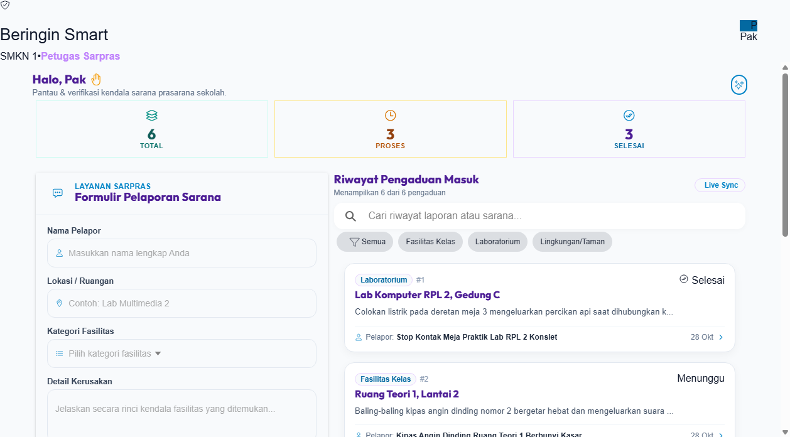
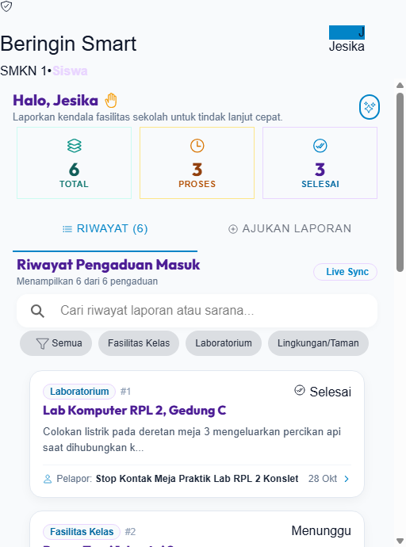

# Beringin Smart 🏫 • Jesika Sitorus Edition

<div align="center">
  
  <h2>Sistem Informasi & Manajemen Pengaduan Sarana Prasarana Sekolah</h2>
  <p><strong>SMK Negeri 1 Beringin Deli Serdang</strong></p>
  <p><em>Tema Desain: Nordic Slate & Arctic Azure (Modern Corporate Tech Hub)</em></p>
</div>

---

## 📌 Identitas Proyek & Pengembang

| Atribut | Informasi Terdaftar |
| :--- | :--- |
| **Nama Siswa** | **Jesika Sitorus** |
| **Kelas & Jurusan** | **XI Pengembangan Perangkat Lunak & Gim 1 (XI PPLG 1)** |
| **Sekolah** | SMK Negeri 1 Beringin, Deli Serdang |
| **Petugas / Teknisi** | Pak Teguh *(Petugas Sarana & Prasarana SMKN 1 Beringin)* |
| **Database Aktif** | MySQL: `beringin_smart_jesika` |
| **Teknologi Backend** | Laravel 11 Framework, REST API, Sanctum Authentication |
| **Teknologi Frontend** | Ionic 8 React, Vite, TypeScript, Nordic Slate Design System |

---

## 🎨 Karakteristik & Filosofi Desain

Edisi Jesika mengusung konsep **Nordic Slate & Arctic Azure**:
- **Palet Warna**: Aksen utama Arctic Azure (`#0284c7`), permukaan Slate (`#0f172a`), dan canvas lembut (`#f8fafc`).
- **Kartu & Komponen**: Struktur card ramping dengan radius presisi `16px` dan border halus `rgba(2, 132, 199, 0.2)`.
- **Halaman Login**: Menampilkan lencana resmi logo SMKN 1 Beringin dengan bingkai kubik modern dan tombol aksi rectangular elegan.
- **Header Beranda**: Banner modern dengan identitas sekolah dan status pelapor terintegrasi.

---

## 📸 Dokumentasi Tangkapan Layar Aplikasi

Berikut adalah hasil pengujian langsung sistem Beringin Smart edisi Jesika Sitorus:

| No | Modul / Halaman | Tangkapan Layar |
| :---: | :--- | :--- |
| **01** | **Portal Autentikasi Pengguna**<br>Halaman login utama dengan logo sekolah resmi SMKN 1 Beringin |  |
| **02** | **Validasi Keamanan & Notifikasi Sandi**<br>Uji ketahanan input dan respon peringatan kredensial |  |
| **03** | **Beranda Feed Pelapor Siswa**<br>Feed tiket pengaduan aktif lengkap dengan kartu status |  |
| **04** | **Rincian Informasi Kerusakan Sarpras**<br>Halaman detail laporan dengan data lokasi dan status penanganan |  |
| **05** | **Penyaringan Kategori Kerusakan**<br>Fitur filter chip untuk menyortir laporan laboratorium & fasilitas |  |
| **06** | **Formulir Pengaduan Sarana Baru**<br>Antarmuka formulir pengisian kerusakan sarpras terpadu |  |
| **07** | **Konfirmasi Laporan Baru Terdaftar**<br>Tiket baru langsung masuk ke urutan teratas feed sarpras |  |
| **08** | **Pusat Kontrol Petugas Sarpras**<br>Antarmuka khusus Pak Teguh untuk memantau status sarpras sekolah |  |
| **09** | **Panel Eksekusi Penanganan Petugas**<br>Tinjauan verifikasi detail pekerjaan sarpras oleh teknisi |  |
| **10** | **Status Penanganan Selesai**<br>Verifikasi tiket yang telah tuntas diperbaiki oleh tim sarpras |  |
| **11** | **Tampilan Responsif Perangkat Seluler**<br>Tata letak antarmuka mobile diuji pada viewport smartphone |  |

---

## 🚀 Panduan Menjalankan Aplikasi di Lokal

### 1. Prasyarat Sistem
- **Laragon / XAMPP**: Pastikan MySQL berjalan pada port `3306`.
- **PHP**: Versi 8.2 atau lebih baru.
- **Node.js**: Versi 18 atau 20 LTS.

### 2. Konfigurasi Database
1. Buka Laragon / MySQL Client, buat database:
   ```sql
   CREATE DATABASE beringin_smart_jesika;
   ```
2. Pastikan file `.env` pada folder `beringin-backend` memuat:
   ```env
   DB_CONNECTION=mysql
   DB_HOST=127.0.0.1
   DB_PORT=3306
   DB_DATABASE=beringin_smart_jesika
   DB_USERNAME=root
   DB_PASSWORD=
   ```

### 3. Menjalankan Server Backend
```bash
cd beringin-backend
php artisan serve
```
Backend berjalan di: `http://127.0.0.1:8000`

### 4. Menjalankan Aplikasi Frontend
```bash
cd Beringin-Smart
npm run dev
```
Frontend berjalan di: `http://127.0.0.1:5173`

### 5. Akun Pengujian
- **Akun Siswa**: `jesika@beringin.sch.id` | Kata Sandi: `password123`
- **Akun Petugas**: `petugas@beringin.sch.id` | Kata Sandi: `password123`
- **Akun Siswa Umum**: `siswa@beringin.sch.id` | Kata Sandi: `password123`